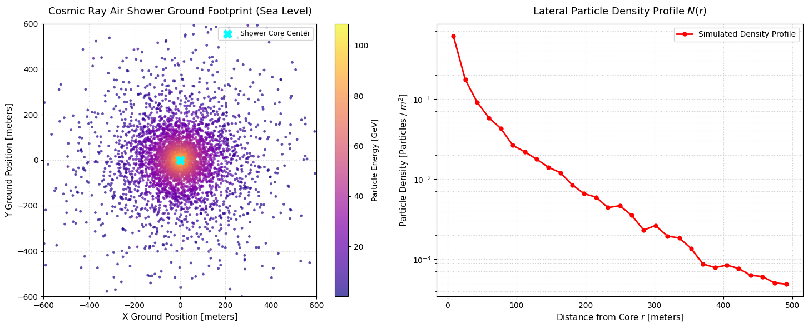

# Cosmic-Ray-Air-Shower-Ground-Footprint-Mapper
# Cosmic Ray Air Shower Ground Footprint Mapper

A Python-based stochastic Monte Carlo simulation of secondary particle cascades generated by ultra-high-energy cosmic rays in Earth's atmosphere.

## Project Highlights
* **Atmospheric Cascade Model:** Models lateral spread (NKG radial distribution) and energy decay across 5,000 secondary particles.
* **Instrumentation Context:** Mimics surface detector array observations (such as Pierre Auger Observatory).
* **Key Visuals:** Features a 2D spatial footprint of ground hits alongside a logarithmic lateral particle density profile $N(r)$.

